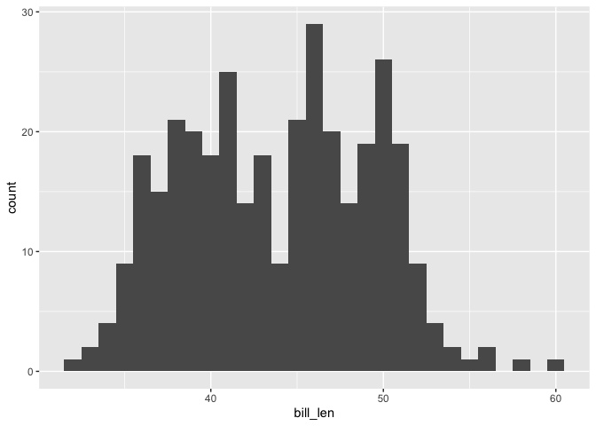

<!-- README.md is generated from README.Rmd. Please edit that file -->

# assignmentB2CourtneyOsborne

<!-- badges: start -->

<!-- badges: end -->

The goal of assignmentB2CourtneyOsborne is to help statistians with
visualisation of their data during preliminary data analysis.

## Installation

You can install the development version of assignmentB2CourtneyOsborne
from [GitHub](https://github.com/) with:

``` r
devtools::install_github("UBC-STAT545-F2026/assignmentB2CourtneyOsborne")
```

## Example

This is a basic example which shows you how to solve a common problem:

``` r
library(assignmentB2CourtneyOsborne)
histogram(penguins, bill_len)
#> Warning: Removed 2 rows containing non-finite outside the scale range
#> (`stat_bin()`).
```


